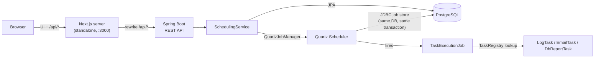

# Scheduling System

[](https://github.com/assafm7/scheduling-system/actions/workflows/ci.yml)

A full-stack app for scheduling executions of predefined tasks. You can schedule one-time runs, every-N-minutes/hours/days intervals, weekly runs, or Quartz cron expressions, each in a chosen time zone.

| Layer | Technology |
|---|---|
| Frontend | Next.js 16 (App Router) · React 19 · TypeScript · Ant Design 6 · TanStack Query |
| Backend | Java 21 · Spring Boot 4.1 · Quartz 2.5 (JDBC job store) · Spring Data JPA · Flyway |
| Database | PostgreSQL 17 |
| Tests | JUnit 5 · Mockito · Testcontainers · JaCoCo · Vitest · React Testing Library |
| Delivery | Docker multi-stage images · docker-compose |

```
/backend    Spring Boot service (REST API + Quartz)
/frontend   Next.js UI
/docker     docker-compose.yml, dev override, .env.example
```

---

## Quick start (for reviewers)

**You only need [Git](https://git-scm.com/) and [Docker Desktop](https://www.docker.com/products/docker-desktop/)** (or Docker Engine with Compose v2). Java, Maven and Node are *not* required: everything builds inside Docker.

**1. Clone the repo:**

```bash
git clone https://github.com/assafm7/scheduling-system.git
cd scheduling-system/docker
```

**2. Create `docker/.env` with a database password.**

The app has no built-in default credentials, so you need to set one. Any value works. The file is git-ignored. Pick one of these:

```bash
# macOS / Linux / Git Bash
echo "POSTGRES_PASSWORD=$(openssl rand -hex 16)" > .env
```
```powershell
# Windows PowerShell
"POSTGRES_PASSWORD=$([guid]::NewGuid().ToString('N'))" | Out-File -Encoding ascii .env
```

Or copy `.env.example` to `.env` and fill in a value.

**3. Build and start everything:**

```bash
docker compose up --build
```

The first build takes a few minutes while it downloads Maven and npm dependencies.

**4. Open http://localhost:3000.**

### Try it out

1. Click **New scheduling**, choose the **Log message** task, enter a message, choose **Interval → every 1 minute**, and save. The form previews the next 5 run times before you save.
2. In a second terminal, run `docker compose logs -f backend` from the `docker/` folder. Your message appears within about a minute, tagged with the scheduling's id.
3. Try the other options:
   - a **Weekly** or **Cron** schedule (e.g. `0 0/2 * * * ?`)
   - the **Send email (simulated)** or **Database report** task
   - **editing** a row
   - the **Enabled** switch, which pauses a scheduling
   - **deleting** a row
4. Submit a form with a required parameter left empty, or with an invalid cron expression. Validation runs in the UI and again in the backend.
5. Restart the stack (`docker compose restart`). Schedulings persist: they live in PostgreSQL, including Quartz's own job store.

**To stop:** press `Ctrl+C`, then run `docker compose down`. Add `-v` to also delete the database volume.

**Troubleshooting:**
- *"required variable POSTGRES_PASSWORD is missing a value"*: step 2 was skipped. Run it from inside the `docker/` folder.
- *Port 3000 is already in use*: change `"3000:3000"` in `docker/docker-compose.yml` to e.g. `"3001:3000"`.

**Notes:**
- Only the UI port is published. Postgres and the backend stay on the internal Docker network, and the UI reaches the API through the Next.js `/api` rewrite.
- Task output goes to the backend log.

---

## Running for development

```bash
# 1. Database only, published on 127.0.0.1:5432
cd docker && docker compose -f docker-compose.yml -f docker-compose.dev.yml up -d db

# 2. Backend on :8080 (JDK 21). Reads DB_URL / DB_USERNAME / DB_PASSWORD from the environment
cd backend && set -a && . ../docker/.env && set +a && DB_PASSWORD="$POSTGRES_PASSWORD" ./mvnw spring-boot:run

# 3. Frontend on :3000. /api is proxied to http://localhost:8080 (override with BACKEND_URL)
cd frontend && npm ci && npm run dev
```

### Tests

```bash
cd backend  && ./mvnw verify          # unit + integration (needs Docker for Testcontainers)
                                      # coverage: backend/target/site/jacoco/index.html
cd frontend && npm test               # unit + component tests
cd frontend && npm run test:coverage  # coverage report in frontend/coverage
cd frontend && npm run lint && npm run typecheck
```

Run a single test with `./mvnw test -Dtest=TriggerFactoryTest` or `npx vitest run src/path/to/file.test.tsx`.

**CI** (`.github/workflows/ci.yml`) runs on every push and pull request:
- backend `./mvnw verify`, including the Testcontainers integration tests
- frontend lint, typecheck, tests with coverage, and production build
- a Docker image build of the whole stack

Coverage reports are uploaded as artifacts. The workflow has read-only permissions, and its actions are pinned to commit SHAs.

---

## Features

- **Table of schedulings** showing task, a human-readable schedule, parameters, next run, enable/disable switch and status. You can create, edit and delete (with confirmation) from the table.
- **Create/edit form:**
  - Pick a task from the predefined list.
  - Its parameter inputs are generated from the task's **parameter schema** (name, type, required).
  - Configure the timing.
  - The form shows a **live preview of the next 5 runs**, calculated by the backend from the same trigger logic Quartz uses.
- **Four schedule types:**

  | Type | Example | Quartz trigger |
  |---|---|---|
  | One-time | 2026-12-01 09:00 Asia/Jerusalem | `SimpleTrigger` (fire once) |
  | Interval | every 15 minutes / 2 hours / 1 day | `SimpleTrigger` repeating forever |
  | Weekly | Mon, Wed at 09:30 | `CronTrigger` (`0 30 9 ? * MON,WED`) |
  | Cron | `0 0/15 9-17 ? * MON-FRI` | `CronTrigger` (Quartz syntax, with seconds) |

- **Predefined, read-only tasks** (defined in code and exposed only through `GET /api/tasks`):

  | Key | What it does | Parameters |
  |---|---|---|
  | `LOG` | Writes a message to the application log | `message` (string, required), `level` (INFO/WARN/ERROR) |
  | `EMAIL` | *Simulated* email: logs what would be sent | `to` (email, required), `subject` (required), `body` |
  | `DB_REPORT` | Runs a predefined read-only SQL report and logs it | `report` (enum: `SCHEDULING_COUNT`, `SCHEDULINGS_PER_TASK`) |

- **Required parameters are enforced in both places**: by the form (rules from the schema) and by the backend, which is authoritative.

### REST API

| Method | Path | Notes |
|---|---|---|
| `GET` | `/api/tasks` | Task catalog with parameter schemas |
| `GET` | `/api/schedulings` | All schedulings, newest first, with `status` and `nextFireTime` |
| `GET` | `/api/schedulings/{id}` | Returns 404 if the scheduling doesn't exist |
| `POST` | `/api/schedulings` | Returns 201 with a `Location` header |
| `PUT` | `/api/schedulings/{id}` | Requires `version` (optimistic locking). Returns 409 on a stale version |
| `DELETE` | `/api/schedulings/{id}` | Returns 204 |
| `POST` | `/api/schedulings/preview` | Validates a schedule and returns its next 5 fire times |

Errors are RFC 9457 `ProblemDetail`s. Validation errors include a field-keyed map, which the UI attaches directly to the matching form fields:

```json
{ "status": 400, "title": "Validation failed",
  "errors": { "parameters.to": "must be a valid email address",
              "schedule.expression": "must not fire more often than once a minute" } }
```

---

## Architecture



**Request flow when creating a scheduling:**

1. The controller runs Bean Validation.
2. `SchedulingService` validates everything up front, so the client gets *every* field error in one response:
   - the task exists,
   - the parameters match the task's schema (`ParameterValidator`),
   - the schedule is valid (`TriggerFactory`).
3. In **one transaction**, it saves the `scheduling` row and writes the Quartz job and trigger.
4. When the trigger fires, the generic `TaskExecutionJob` reads `taskKey` and the JSON parameters from the job data. It looks up the task in `TaskRegistry` and calls `execute(TaskContext)`.

---

## Design decisions

1. **Quartz JDBC job store in the same Postgres, inside the same transaction.**
   - Spring's `LocalDataSourceJobStore` puts Quartz writes on the caller's transaction. So the `scheduling` row and its job and trigger **commit or roll back together**, and the table and the scheduler can never drift apart.
   - An integration test proves this: it forces a failure *after* the Quartz write, then asserts that neither the row nor the job exists.
   - Schedules survive restarts, and `isClustered=true` makes it safe to run several backend replicas.
2. **One generic job class, one durable job per scheduling** (`JobKey = schedulingId`).
   - Tasks are plain Spring beans behind a `ScheduledTask` interface. Adding a task means adding one `@Component`; there's no Quartz code to touch.
   - Jobs are durable, so a finished one-time scheduling can still be edited and re-armed.
3. **Schedules are a sealed, polymorphic `ScheduleSpec`** (records for each type).
   - They're stored as JSON text, with a `type` discriminator and an explicit `@JsonSubTypes` allow-list.
   - `TriggerFactory` is the single place that validates a spec and maps it to a trigger. It's pure apart from an injected `Clock`, so it's fully unit-tested.
   - The same code powers the UI's "next runs" preview, so the preview can't disagree with real execution.
4. **Edits use delete-then-schedule, not `replace=true`.** Quartz's JDBC store can't replace a trigger with one of a *different type* (e.g. cron → interval); it leaves a dangling row. Our integration test caught this. Deleting and re-creating in the same transaction is still atomic.
5. **Low `idleWaitTime` (5s).** Because scheduling happens inside our transaction, Quartz's "new trigger" wake-up can run before commit and not see the trigger yet. A short idle wait caps that pickup delay at about 5s, instead of the default 30s, at the cost of one cheap DB poll per 5s.
6. **Parameter schema per task (bonus).**
   - Each task declares its parameters: name, label, type (`STRING`, `NUMBER`, `BOOLEAN`, `EMAIL`, `ENUM`), required flag, and options or max length.
   - The UI renders the form from the schema.
   - The backend validates and normalizes values against it. It rejects unknown parameters, trims strings and parses numbers and booleans.
7. **Optimistic locking.** `PUT` must send the `version` it read. Concurrent edits get a 409 instead of a silent lost update.
8. **Same-origin API via a Next.js rewrite.** The browser only ever talks to the Next.js server, so there's no CORS configuration at all. The backend isn't exposed outside the compose network.
9. **Flyway owns all DDL.** That includes the official Quartz Postgres schema (V1) and our table (V2). Hibernate only *validates* the schema.
10. **Misfire policies:**
    - One-time: fire immediately if missed.
    - Interval: skip to the next slot.
    - Cron and weekly: fire once now, then proceed.

## Assumptions

- **No authentication.** The spec doesn't mention users, so this is treated as a single-user internal tool. The only published port is the UI. Adding Spring Security with OIDC (and a per-user owner column) would be the next step.
- **Tasks are defined in code.** They're read-only by design, and "predefined" means they ship with the service.
- **The simulated email task sends nothing.** It logs the recipient, subject and body length, but not the body.
- **Time zones.** Each schedule carries an IANA time zone, defaulting to the browser's. The table shows next-run times in the viewer's local time.
- **Interval schedules start one interval after they're saved or edited.** Saving "every 15 minutes" first fires in 15 minutes, not immediately.
- **Minimum frequency is once per minute,** for both intervals and cron. Higher frequencies are rejected as a resource-exhaustion guard.
- **Disabled schedulings** keep their Quartz job but their trigger is paused. Re-enabling reschedules them from now.
- **One-time schedulings** must be in the future when saved. Once they fire, their status becomes `COMPLETED`.

## Security review (OWASP Top 10:2025)

| # | Risk in this system | Mitigation |
|---|---|---|
| A01 Broken Access Control | Tasks must stay read-only. Guessable IDs. SSRF | No task write endpoints. UUID identifiers. No CORS (same-origin only). No URL-fetching task (an HTTP-ping task was deliberately left out because of SSRF) |
| A02 Security Misconfiguration | Default credentials, exposed services or consoles | DB password **required** from a git-ignored `.env` (compose fails fast without it), with no defaults. Only the UI port is published. Actuator exposes `health` only, with no details. Error responses never include stack traces or messages. Security headers (CSP, `X-Frame-Options: DENY`, `nosniff`, Referrer and Permissions policies). Containers run as non-root |
| A03 Software Supply Chain Failures | Vulnerable or unpinned dependencies | Current supported versions (Spring Boot 4.1, Next.js 16). `package-lock.json` with `npm ci`. Maven wrapper. Pinned image tags. Few dependencies. `npm audit --omit=dev` reports **0** vulnerabilities. The remaining advisories are dev-only lint tooling (`picomatch` ReDoS via eslint) and never reach the runtime image |
| A04 Cryptographic Failures | Secrets at rest or in transit | No sensitive data stored. Secrets only via environment or `.env`. TLS termination belongs in front of the UI in a real deployment (ingress or load balancer) |
| A05 Injection | SQL, log or cron injection | JPA plus parameterized queries only. `DB_REPORT` picks from an allow-list of fixed SQL. Every parameter is validated against its schema server-side. Cron is parsed and validated. Control characters are stripped before logging (no forged log lines). React escapes all output, and there's no `dangerouslySetInnerHTML` |
| A06 Insecure Design | Schedules used for resource exhaustion | Maximum frequency of once a minute. Length limits on every field. `@DisallowConcurrentExecution`. A bounded Quartz thread pool |
| A07 Authentication Failures | No auth in the scope | Documented assumption (see above). The attack surface is limited to the single published UI port |
| A08 Software or Data Integrity Failures | Unsafe deserialization | Polymorphic JSON is limited to an explicit subtype allow-list, with no default typing. Quartz `useProperties=true` keeps job data as strings only, so there's no Java serialization through the database |
| A09 Security Logging and Alerting Failures | Missing or forged audit trail | Create, update and delete are logged with IDs. Every job run and failure is logged with `schedulingId` and `taskKey` in the MDC. Logged user input is sanitized |
| A10 Mishandling of Exceptional Conditions | Leaking internals, scheduler crashes | A global `ProblemDetail` handler with a generic 500. Task failures are caught and contained (no immediate refire loop). Validation fails closed |

## Testing

- **Backend: 60 tests, 96.6% line and 86.5% branch coverage** (JaCoCo).
  - Unit tests cover:
    - the parameter validator (parameterized)
    - the trigger factory (every type, time zones, edge cases, preview)
    - the task registry
    - each task, including log-injection neutralization
    - the execution job (failure containment)
    - the scheduling service (mocks)
  - **Integration tests** (`SchedulingApiIntegrationTest`) run the real HTTP → JPA → Flyway → Quartz stack against **PostgreSQL in Testcontainers**:
    - the full CRUD lifecycle, asserting the Quartz state at each step
    - ProblemDetail validation errors, 404 and 409
    - a **real job firing** with its parameters
    - DB and Quartz **rollback atomicity**
- **Frontend:** see [Frontend tests](#frontend-tests).

### Frontend tests

_To be completed after the frontend merge._

## Use of AI tools

This project was built with **Claude Code** (Anthropic's CLI agent, model Claude Opus 5.5) as a pair programmer:

- **Planning:** turning the assignment PDF into an implementation plan, a 3-hour timeline, an API contract and the OWASP review. I reviewed and changed it, for example choosing Next.js over Vite and Java 21.
- **Implementation:** Claude Code wrote the code. The frontend was built in parallel by a separate Claude Code sub-agent working on its own git branch (`feature/frontend`) against the agreed API contract, then merged.
- **Verification:** Claude Code ran builds, tests, smoke tests and Docker locally. The integration tests surfaced a real Quartz issue (changing the trigger type on edit), which led to design decision 4.
- Commits made with AI assistance carry a `Co-Authored-By: Claude` trailer.
